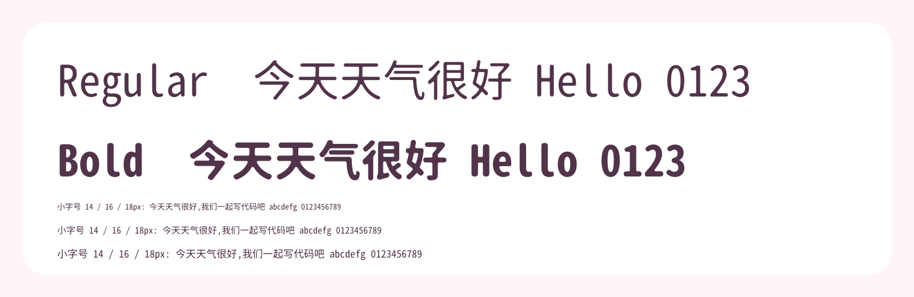

# Mochi Mono 🍡

圆润软萌的等宽字体,适合写代码,也适合日常阅读 ♥
A soft, rounded monospace font for coding and everyday reading — Simplified & Traditional Chinese, English, digits and symbols.


## 特点 Features

- **圆润可爱**:所有笔画端点与转角都做了圆角处理,Regular 和 Bold 两个字重
- **严格等宽**:英文/数字占 1 格,汉字占 2 格(500 / 1000 单位),终端与编辑器里对齐不跑偏
- **简繁都有**:覆盖 GB2312(简体)与 Big5(繁體)全部汉字,约 1.6 万字
- **拼音友好**:ā á ǎ à、ü、ǖ 等拼音字母已对齐到等宽网格
- **还有这些**:ASCII、Latin-1、常用标点与全角符号、箭头、数学符号、制表符、平假名、片假名、注音符号




## 下载与安装 Install

在 `fonts/` 里下载 `MochiMono-Regular.otf` 和 `MochiMono-Bold.otf`,双击安装即可。

编辑器里设置字体名为 `Mochi Mono`,例如 VS Code:

```json
"editor.fontFamily": "'Mochi Mono', monospace"
```

## 自己构建 Build

基于 Noto Sans Mono CJK SC,用 [fontTools](https://github.com/fonttools/fonttools) 对轮廓做圆角化:

```bash
pip install fonttools
python3 build/build.py \
  --regular NotoSansCJK-Regular.ttc \
  --bold NotoSansCJK-Bold.ttc \
  --out fonts
python3 build/preview.py   # 生成 images/ 里的预览图(需要 Pillow)
```

圆角半径可以在 `build/build.py` 的 `PARAMS` 里调整(`r_convex` 外角,`r_concave` 内角)。

## 已知限制 Notes

- 没有编程连字(ligatures),也没有斜体
- 只收录了常用字符集,不含生僻字、日文汉字变体和韩文
- 纯圆角化处理,没有逐字手工调整,个别字的笔画交界处可能还有小瑕疵,欢迎提 issue

## 授权 License

基于 [Noto Sans Mono CJK SC](https://github.com/notofonts/noto-cjk)(© 2014-2021 Adobe)修改,
使用 [SIL Open Font License 1.1](OFL.txt) 发布。
