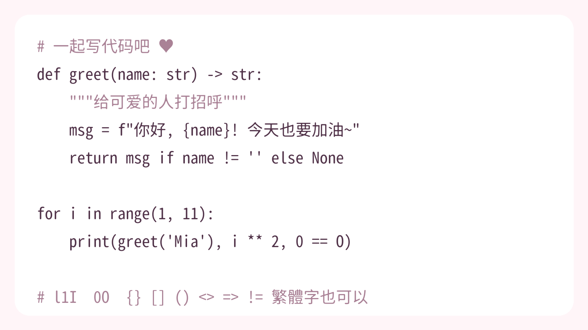
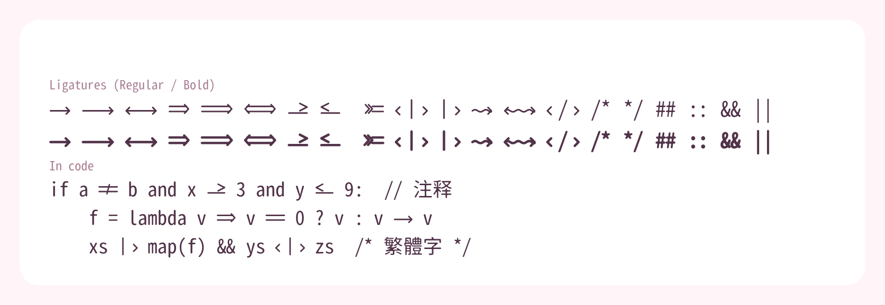
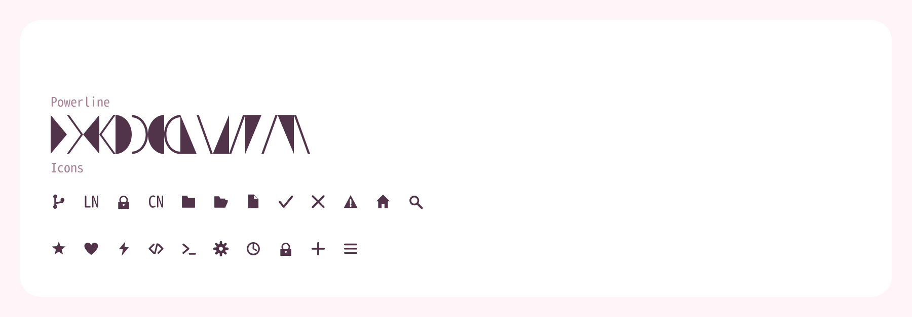

# Mochi Mono

圆润软萌的等宽字体,适合写代码,也适合日常阅读。
A soft, rounded monospace font for coding and everyday reading: Simplified and Traditional Chinese, English, digits and symbols.


## 两个版本 Two families

| 字体 Family | 文件 Files | 说明 |
| --- | --- | --- |
| **Mochi Mono** | `MochiMono-Regular.otf`, `MochiMono-Bold.otf` | 基础版,无连字 |
| **Mochi Mono Ligature** | `MochiMonoLigature-Regular.otf`, `MochiMonoLigature-Bold.otf` | 基础版 + 编程连字 + Powerline 符号 + 常用图标 |

## 特点 Features

- **圆润可爱**:所有笔画端点与转角都做了圆角处理,Regular 和 Bold 两个字重
- **严格等宽**:英文和数字占 1 格,汉字占 2 格(500 / 1000 单位),终端与编辑器里对齐不跑偏
- **简繁都有**:覆盖 GB2312(简体)与 Big5(繁體)全部汉字,约 1.6 万字
- **拼音友好**:ā á ǎ à、ü 等拼音字母已对齐到等宽网格
- **其他字符**:ASCII、Latin-1、常用标点与全角符号、箭头、数学符号、制表符、平假名、片假名、注音符号




## 连字版 Ligature family

编程连字(`calt` / `liga`),共 162 个,分为这几类:

| 类别 | 连字 |
| --- | --- |
| 箭头 | `->` `-->` `->>` `<-` `<--` `<<-` `<->` `<-->` `>->` `<-<` `-<` `-<<` `>-` `>>-` `<-\|` `\|->` `\|-->` |
| 双线箭头 | `=>` `==>` `=>>` `<==` `<=>` `<==>` `===>` `<===` `>=>` `<=<` `>>=` `<<=` `=<<` `<=\|` `\|=>` |
| 波浪线 | `~>` `~~>` `<~` `<~~` `<~>` `~~` `~~~` `~=` `=~` `-~` `~-` `!~` |
| 管道 | `\|>` `<\|` `<\|>` `\|\|>` `<\|\|` `\|\|\|>` `<\|\|\|` `\|-` `-\|` `\|=` `\|\|=` |
| 比较 | `==` `===` `====` `!=` `!==` `/=` `/==` `=/=` `=!=` `>=` `<=` |
| 赋值 | `:=` `=:` `::=` `=:=` `?=` `^=` `+=` `-=` `*=` `%=` `&=` `.=` |
| 尖括号 | `<<` `>>` `<<<` `>>>` `<>` `<$>` `<$` `$>` `<*>` `<*` `*>` `<+>` `<+` `+>` `<:` `:>` `<:<` `>:>` `</>` `</` `/>` |
| 注释 | `//` `///` `/*` `*/` `/**` `**/` `<!--` `<!---` |
| 重复符号 | `&&` `\|\|` `::` `..` `...` `;;` `##` `###` `####` `**` `***` `++` `+++` `??` `!!` `%%` `^^` `__` `\\` 等 |
| 其他 | `#(` `#{` `#[` `#_` `#?` `#!` `#:` `{\|` `\|}` `[\|` `\|]` `..<` `..=` `?.` `?:` `!.` 等 |



另外包含:

- **Powerline 与 Powerline Extra**:U+E0A0 到 U+E0A3、U+E0B0 到 U+E0BF,终端状态栏(oh-my-posh、starship、tmux、vim-airline 等)可用
- **常用图标**:按 Nerd Font 的码位手绘了一小部分,包括 git 分支、文件夹、文件、对勾、叉、警告、主页、搜索、星标、爱心、闪电、代码、终端、齿轮、时钟、锁、加号、菜单



图标只是手绘的一小部分,**不是完整的 Nerd Fonts 图标库**。需要全部图标的话,可以用 [Nerd Fonts patcher](https://github.com/ryanoasis/nerd-fonts) 给本字体打补丁,或者在编辑器里把 Nerd Font 设为备用字体。

不想要连字的话,在编辑器里关掉连字功能,或者直接使用基础版。

## 下载与安装 Install

在 `fonts/` 里下载需要的 `.otf` 文件,双击安装即可。

在编辑器里设置字体名,例如 VS Code:

```json
"editor.fontFamily": "'Mochi Mono Ligature', monospace",
"editor.fontLigatures": true
```

## 自己构建 Build

基于 Noto Sans Mono CJK SC,用 [fontTools](https://github.com/fonttools/fonttools) 处理:

```bash
pip install fonttools

# 1. 基础版:圆角化
python3 build/build.py \
  --regular NotoSansCJK-Regular.ttc \
  --bold NotoSansCJK-Bold.ttc \
  --out fonts

# 2. 连字版:在基础版上添加连字、Powerline 和图标
python3 build/build_ligature.py --src fonts --out fonts

# 3. 预览图(需要 Pillow 和 Playwright)
python3 build/preview.py
python3 build/preview_ligature.py
```

圆角半径可以在 `build/build.py` 的 `PARAMS` 里调整(`r_convex` 外角,`r_concave` 内角)。

## 已知限制 Notes

- 没有斜体
- 只收录了常用字符集,不含生僻字、日文汉字变体和韩文
- 圆角是程序统一处理的,没有逐字手工调整,个别字的笔画交界处可能有小瑕疵,欢迎提 issue
- 连字是程序按规则用线条和字形拼出来的,没有逐个手工调整;`>>=`、`>=>` 这类多个箭头头叠在一起的形状比较紧凑,欢迎反馈

## 授权 License

基于 [Noto Sans Mono CJK SC](https://github.com/notofonts/noto-cjk)(Copyright 2014-2021 Adobe)修改,
使用 [SIL Open Font License 1.1](OFL.txt) 发布。
